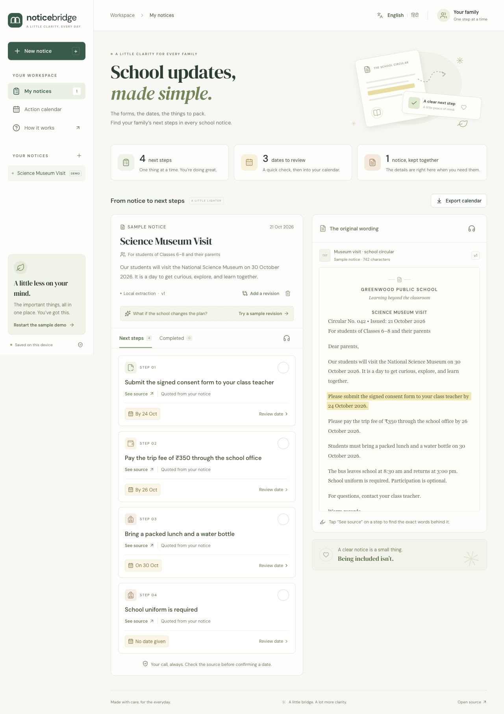

# NoticeBridge

School circulars get buried in message threads. NoticeBridge puts the instructions, deadlines, and revised plans on one noticeboard.



## What it does

- Reads PDFs, English screenshots, and pasted notices.
- Turns instructions into a checklist, with the exact source text attached to each step.
- Compares revised circulars and marks changed deadlines, added instructions, and removals.
- Exports confirmed dates to a calendar file.
- Supports Hindi translations and read-aloud, with an editable name, school, and class for your board.

## Run

Node.js 22 or newer.

```sh
npm install
npm run dev
```

Open [localhost:3000](http://127.0.0.1:3000). The sample notice and local English extraction work without an API key.

## AI extraction and translation

```sh
cp .env.example .env.local
```

Set `OPENAI_API_KEY` in `.env.local` and restart the app. `OPENAI_MODEL` defaults to `gpt-4.1-mini`.

Choose AI processing when importing a notice to enable richer extraction and Hindi translation. This sends the extracted text to OpenAI. The local option processes it in the browser. Saved notices and board preferences stay in this browser.

## Demo

Open the museum-trip notice, select **See source**, and confirm a deadline. Then try the sample revision: the consent deadline moves from 24 to 27 October, and a school ID card is added to the packing list.

## Development

```sh
npm test
npm run typecheck
npm run build
npm run format
```

Extraction, date parsing, revision matching, calendar exports, and the AI endpoint have regression tests. Provider tests use mocked replies.

## Notes

The local extractor handles common English instructions. Full translation of imported notices needs the AI option. OCR text is editable before analysis. Ambiguous dates need confirmation, and exported reminders are all-day events. Calendar files are imported manually; they do not sync automatically.

## Stack

[Next.js](https://nextjs.org/) · [React](https://react.dev/) · [PDF.js](https://github.com/mozilla/pdf.js) · [Tesseract.js](https://github.com/naptha/tesseract.js) · [Zod](https://zod.dev/) · [Lucide](https://lucide.dev/) · [Vitest](https://vitest.dev/) · [OpenAI Responses API](https://developers.openai.com/api/docs/guides/structured-outputs)
